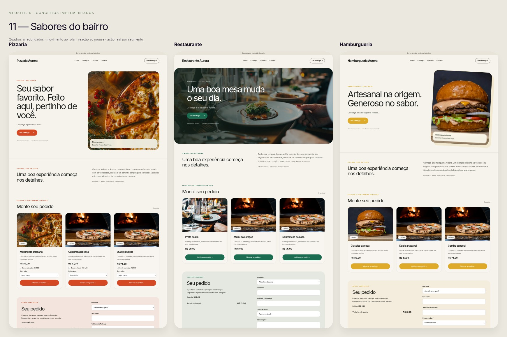
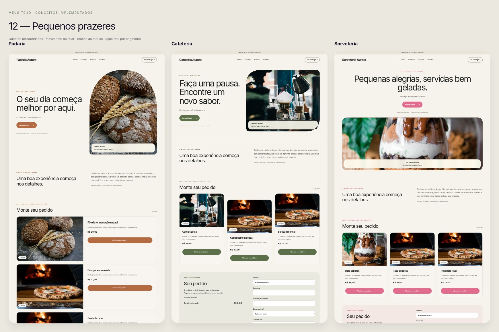
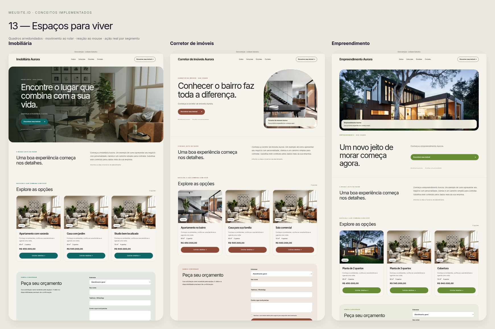
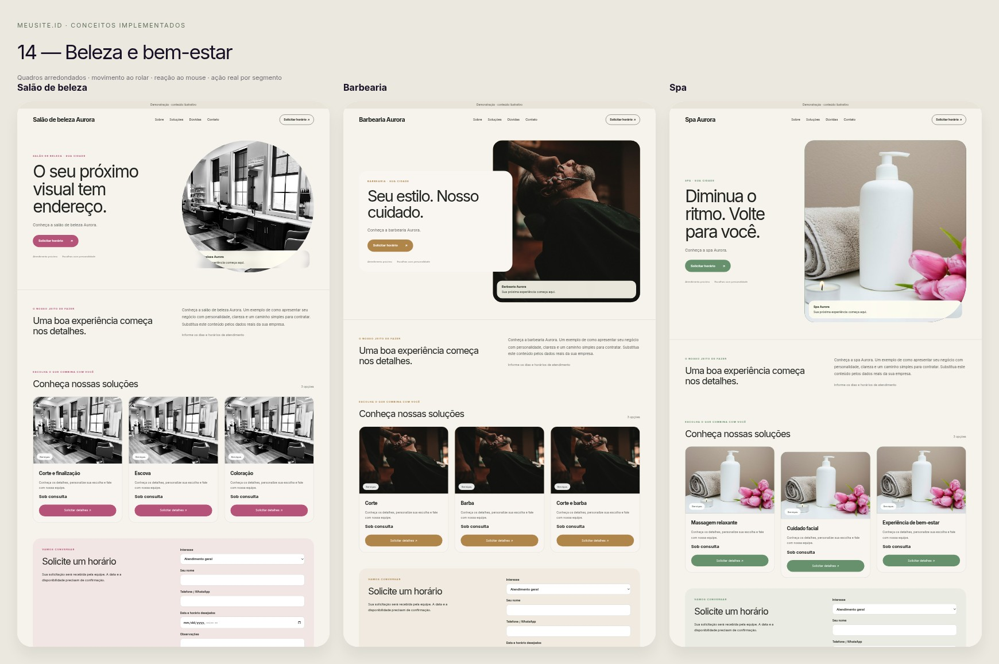
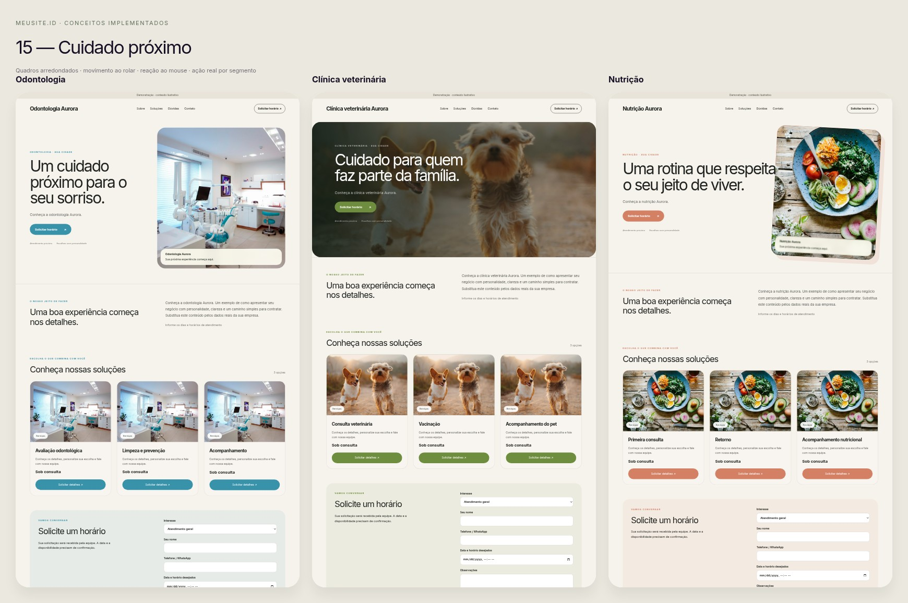
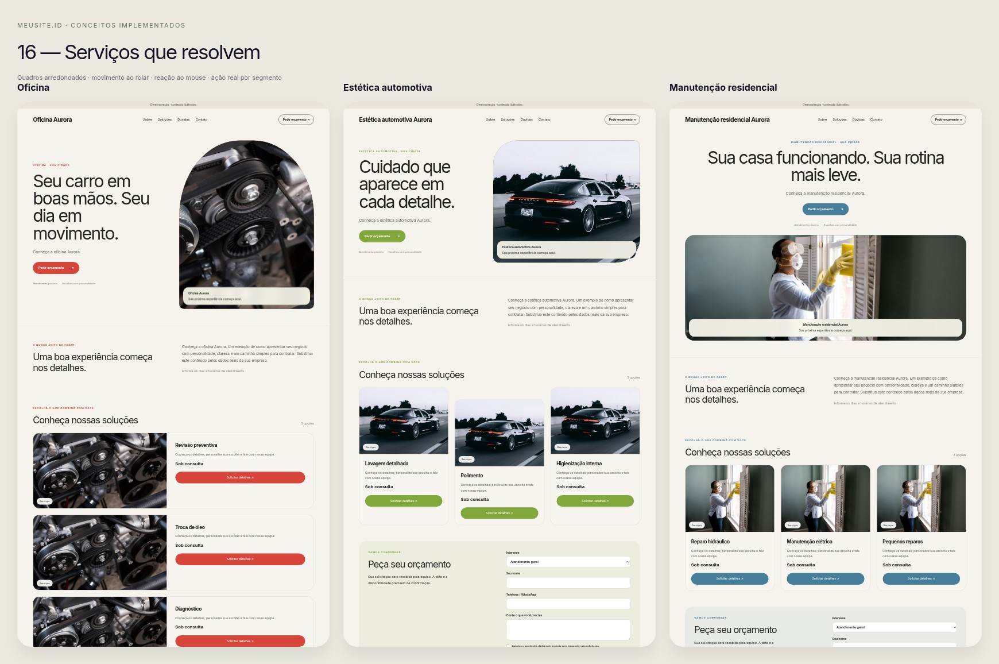
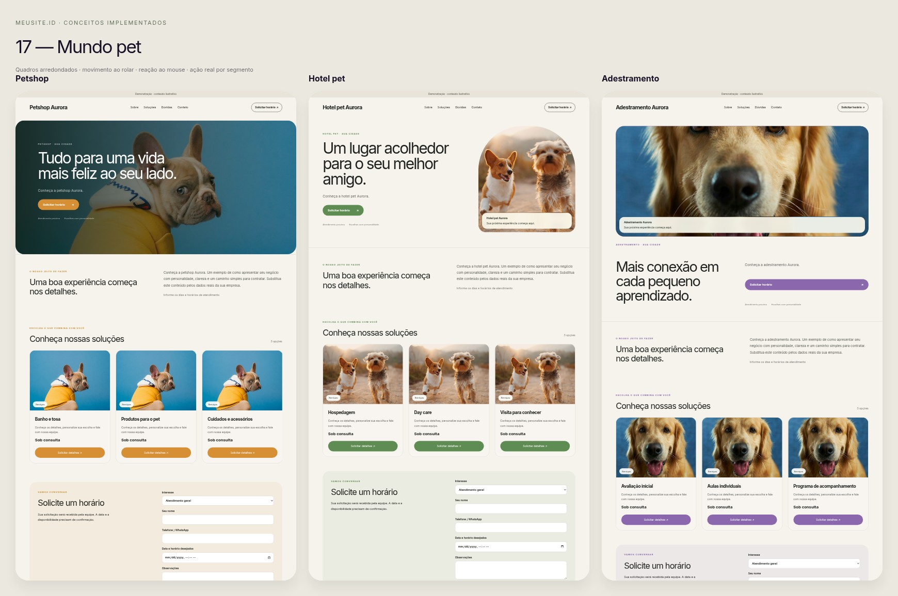
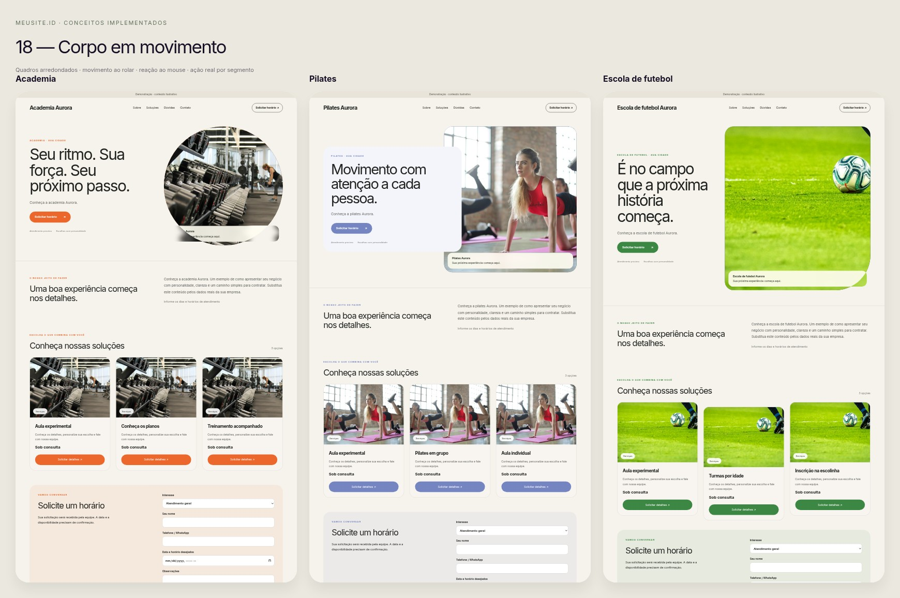
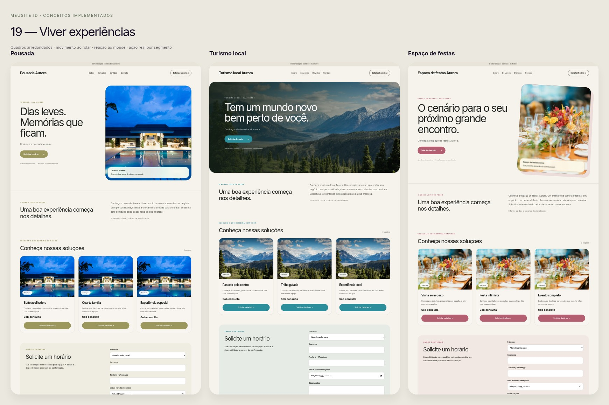
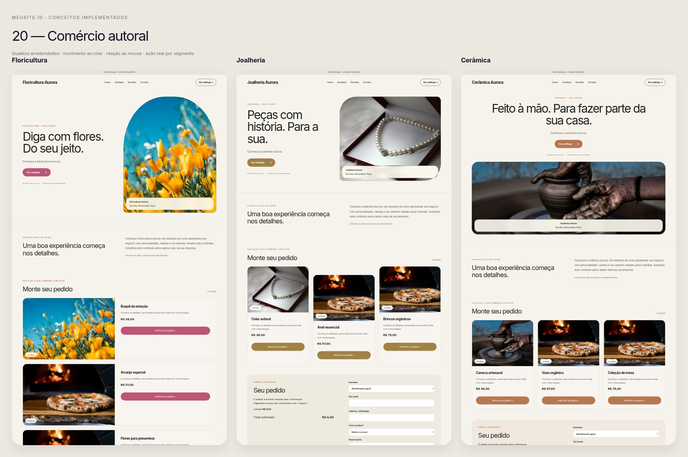

# Catálogo MeuSite — 105 modelos

75 composições da base + 30 direções empresariais. IDs internos são estáveis para salvar e trocar modelos. As pranchas abaixo são capturas das implementações.

## Prancha 11 — Sabores do bairro

- **Pizzaria** — `biz-pizzaria`; composição `split`; objetivo `order`. Exemplo: `/exemplo/biz-pizzaria`.
- **Restaurante** — `biz-restaurante`; composição `poster`; objetivo `order`. Exemplo: `/exemplo/biz-restaurante`.
- **Hamburgueria** — `biz-hamburgueria`; composição `overlap`; objetivo `order`. Exemplo: `/exemplo/biz-hamburgueria`.

## Prancha 12 — Pequenos prazeres

- **Padaria** — `biz-padaria`; composição `editorial`; objetivo `order`. Exemplo: `/exemplo/biz-padaria`.
- **Cafeteria** — `biz-cafeteria`; composição `mosaic`; objetivo `order`. Exemplo: `/exemplo/biz-cafeteria`.
- **Sorveteria** — `biz-sorveteria`; composição `horizontal`; objetivo `order`. Exemplo: `/exemplo/biz-sorveteria`.

## Prancha 13 — Espaços para viver

- **Imobiliária** — `biz-imobiliaria`; composição `cinematic`; objetivo `quote`. Exemplo: `/exemplo/biz-imobiliaria`.
- **Corretor de imóveis** — `biz-corretor`; composição `portrait`; objetivo `quote`. Exemplo: `/exemplo/biz-corretor`.
- **Empreendimento** — `biz-empreendimento`; composição `stage`; objetivo `quote`. Exemplo: `/exemplo/biz-empreendimento`.

## Prancha 14 — Beleza e bem-estar

- **Salão de beleza** — `biz-salao`; composição `minimal`; objetivo `booking`. Exemplo: `/exemplo/biz-salao`.
- **Barbearia** — `biz-barbearia`; composição `cards`; objetivo `booking`. Exemplo: `/exemplo/biz-barbearia`.
- **Spa** — `biz-spa`; composição `story`; objetivo `booking`. Exemplo: `/exemplo/biz-spa`.

## Prancha 15 — Cuidado próximo

- **Odontologia** — `biz-odontologia`; composição `split`; objetivo `booking`. Exemplo: `/exemplo/biz-odontologia`.
- **Clínica veterinária** — `biz-veterinaria`; composição `poster`; objetivo `booking`. Exemplo: `/exemplo/biz-veterinaria`.
- **Nutrição** — `biz-nutricao`; composição `overlap`; objetivo `booking`. Exemplo: `/exemplo/biz-nutricao`.

## Prancha 16 — Serviços que resolvem

- **Oficina** — `biz-oficina`; composição `editorial`; objetivo `quote`. Exemplo: `/exemplo/biz-oficina`.
- **Estética automotiva** — `biz-estetica-auto`; composição `mosaic`; objetivo `quote`. Exemplo: `/exemplo/biz-estetica-auto`.
- **Manutenção residencial** — `biz-manutencao`; composição `horizontal`; objetivo `quote`. Exemplo: `/exemplo/biz-manutencao`.

## Prancha 17 — Mundo pet

- **Petshop** — `biz-petshop`; composição `cinematic`; objetivo `booking`. Exemplo: `/exemplo/biz-petshop`.
- **Hotel pet** — `biz-hotel-pet`; composição `portrait`; objetivo `booking`. Exemplo: `/exemplo/biz-hotel-pet`.
- **Adestramento** — `biz-adestramento`; composição `stage`; objetivo `booking`. Exemplo: `/exemplo/biz-adestramento`.

## Prancha 18 — Corpo em movimento

- **Academia** — `biz-academia`; composição `minimal`; objetivo `booking`. Exemplo: `/exemplo/biz-academia`.
- **Pilates** — `biz-pilates`; composição `cards`; objetivo `booking`. Exemplo: `/exemplo/biz-pilates`.
- **Escola de futebol** — `biz-futebol`; composição `story`; objetivo `booking`. Exemplo: `/exemplo/biz-futebol`.

## Prancha 19 — Viver experiências

- **Pousada** — `biz-pousada`; composição `split`; objetivo `booking`. Exemplo: `/exemplo/biz-pousada`.
- **Turismo local** — `biz-turismo`; composição `poster`; objetivo `booking`. Exemplo: `/exemplo/biz-turismo`.
- **Espaço de festas** — `biz-festas`; composição `overlap`; objetivo `booking`. Exemplo: `/exemplo/biz-festas`.

## Prancha 20 — Comércio autoral

- **Floricultura** — `biz-floricultura`; composição `editorial`; objetivo `order`. Exemplo: `/exemplo/biz-floricultura`.
- **Joalheria** — `biz-joalheria`; composição `mosaic`; objetivo `order`. Exemplo: `/exemplo/biz-joalheria`.
- **Cerâmica** — `biz-ceramica`; composição `horizontal`; objetivo `order`. Exemplo: `/exemplo/biz-ceramica`.

## As 75 composições adaptadas

| ID | Nome no catálogo | Exemplo |
|---|---|---|
| `editor-pro` | Editor Pro | `/exemplo/editor-pro` |
| `grade-suica` | Grade Suíça | `/exemplo/grade-suica` |
| `editorial` | Editorial | `/exemplo/editorial` |
| `impacto` | Impacto | `/exemplo/impacto` |
| `documental` | Documental | `/exemplo/documental` |
| `mosaico` | Mosaico | `/exemplo/mosaico` |
| `portfolio-compacto` | Vitrine compacto | `/exemplo/portfolio-compacto` |
| `curriculo-com-trabalhos` | História com trabalhos | `/exemplo/curriculo-com-trabalhos` |
| `arquivo-editorial` | Arquivo editorial | `/exemplo/arquivo-editorial` |
| `videomaker` | Videomaker | `/exemplo/videomaker` |
| `producao-audiovisual` | Produção audiovisual | `/exemplo/producao-audiovisual` |
| `designer-grafico` | Designer gráfico | `/exemplo/designer-grafico` |
| `motion-design` | Motion design | `/exemplo/motion-design` |
| `fotografia` | Fotografia | `/exemplo/fotografia` |
| `jornalismo` | Jornalismo | `/exemplo/jornalismo` |
| `social-media` | Social media | `/exemplo/social-media` |
| `assessoria-imprensa` | Assessoria de imprensa | `/exemplo/assessoria-imprensa` |
| `locucao-audio` | Locução e áudio | `/exemplo/locucao-audio` |
| `direcao-fotografia` | Direção de fotografia | `/exemplo/direcao-fotografia` |
| `documentarista` | Documentarista | `/exemplo/documentarista` |
| `reporter-tv` | Repórter de TV | `/exemplo/reporter-tv` |
| `direcao-arte` | Direção de arte | `/exemplo/direcao-arte` |
| `redacao-publicitaria` | Redação publicitária | `/exemplo/redacao-publicitaria` |
| `podcast-producao-sonora` | Podcast e produção sonora | `/exemplo/podcast-producao-sonora` |
| `cobertura-eventos` | Cobertura de eventos | `/exemplo/cobertura-eventos` |
| `comunicacao-corporativa` | Comunicação corporativa | `/exemplo/comunicacao-corporativa` |
| `estrategia-conteudo` | Estratégia de conteúdo | `/exemplo/estrategia-conteudo` |
| `estudio-criativo` | Estúdio criativo | `/exemplo/estudio-criativo` |
| `colorista` | Colorista | `/exemplo/colorista` |
| `efeitos-visuais` | Efeitos visuais | `/exemplo/efeitos-visuais` |
| `roteiro-audiovisual` | Roteiro audiovisual | `/exemplo/roteiro-audiovisual` |
| `ilustracao-editorial` | Ilustração editorial | `/exemplo/ilustracao-editorial` |
| `fotojornalismo` | Fotojornalismo | `/exemplo/fotojornalismo` |
| `design-informacao` | Design de informação | `/exemplo/design-informacao` |
| `apresentacao-mediacao` | Apresentação e mediação | `/exemplo/apresentacao-mediacao` |
| `comunicacao-publica` | Comunicação pública | `/exemplo/comunicacao-publica` |
| `ux-writing` | UX Writing | `/exemplo/ux-writing` |
| `producao-criadores` | Produção para criadores | `/exemplo/producao-criadores` |
| `vitrine-multidisciplinar` | Vitrine multidisciplinar | `/exemplo/vitrine-multidisciplinar` |
| `case-em-profundidade` | Case em profundidade | `/exemplo/case-em-profundidade` |
| `servicos-orcamento` | Serviços e orçamento | `/exemplo/servicos-orcamento` |
| `campanhas-resultados` | Campanhas e resultados | `/exemplo/campanhas-resultados` |
| `projetos-digitais` | Projetos digitais | `/exemplo/projetos-digitais` |
| `projetos-educacionais` | Projetos educacionais | `/exemplo/projetos-educacionais` |
| `equipe-projetos` | Equipe e projetos | `/exemplo/equipe-projetos` |
| `motion-editorial-vivo` | Editorial Vivo | `/exemplo/motion-editorial-vivo` |
| `motion-cinema-imersivo` | Cinema Imersivo | `/exemplo/motion-cinema-imersivo` |
| `motion-design-interativo` | Design Interativo | `/exemplo/motion-design-interativo` |
| `motion-galeria-viva` | Galeria Viva | `/exemplo/motion-galeria-viva` |
| `motion-enquadramentos` | Enquadramentos | `/exemplo/motion-enquadramentos` |
| `motion-luz-autoral` | Luz Autoral | `/exemplo/motion-luz-autoral` |
| `motion-orbita` | Órbita | `/exemplo/motion-orbita` |
| `motion-materia` | Matéria | `/exemplo/motion-materia` |
| `motion-fluxo` | Fluxo | `/exemplo/motion-fluxo` |
| `motion-atelie-visual` | Ateliê Visual | `/exemplo/motion-atelie-visual` |
| `motion-retrato` | Retrato | `/exemplo/motion-retrato` |
| `motion-forma-urbana` | Forma Urbana | `/exemplo/motion-forma-urbana` |
| `motion-cena` | Cena | `/exemplo/motion-cena` |
| `motion-frequencia` | Frequência | `/exemplo/motion-frequencia` |
| `motion-palco` | Palco | `/exemplo/motion-palco` |
| `motion-pulso` | Pulso | `/exemplo/motion-pulso` |
| `motion-universos` | Universos | `/exemplo/motion-universos` |
| `motion-sinal` | Sinal | `/exemplo/motion-sinal` |
| `motion-raiz-autoral` | Raiz Autoral | `/exemplo/motion-raiz-autoral` |
| `motion-respiro` | Respiro | `/exemplo/motion-respiro` |
| `motion-mare-documental` | Maré Documental | `/exemplo/motion-mare-documental` |
| `motion-em-cena` | Em Cena | `/exemplo/motion-em-cena` |
| `motion-objeto-grafico` | Objeto Gráfico | `/exemplo/motion-objeto-grafico` |
| `motion-campanha-sensorial` | Campanha Sensorial | `/exemplo/motion-campanha-sensorial` |
| `motion-tipo` | Tipo | `/exemplo/motion-tipo` |
| `motion-colagem` | Colagem | `/exemplo/motion-colagem` |
| `motion-estudio-de-marca` | Estúdio de Marca | `/exemplo/motion-estudio-de-marca` |
| `motion-jardim-digital` | Jardim Digital | `/exemplo/motion-jardim-digital` |
| `motion-sonho-ilustrado` | Sonho Ilustrado | `/exemplo/motion-sonho-ilustrado` |
| `motion-gravidade` | Gravidade | `/exemplo/motion-gravidade` |

## Como os dados entram

Business fornece identidade, apresentação e contato; BusinessItem fornece cards e fichas. adaptBusiness traduz para profile/works sem exigir currículo. Os 30 modelos novos usam o documento empresarial diretamente. Catálogo/pedidos ficam conectados ao mesmo snapshot, qualquer que seja a composição.
